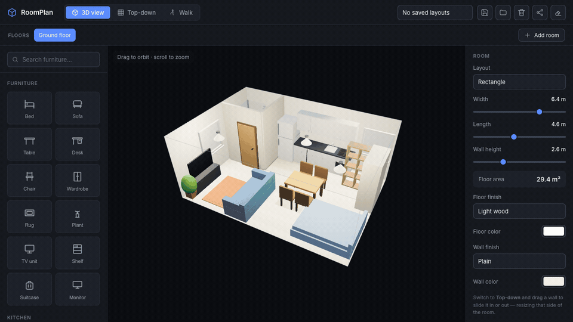

# RoomPlan

Plan a room in 3D before you move in: set its real size, drop in furniture, and check everything fits.



**Try it:** [room-measure.vercel.app](https://room-measure.vercel.app)

## What it does

- **Any room shape.** Rectangle, L, T or U, then drag any wall in top-down view. Lengths and floor area update live.
- **A real catalog.** Living, kitchen, bathroom, stairs, doors, windows, fixtures and lights, sized to real (German DIN) dimensions. Search finds them fast.
- **Arrange freely.** Drag, rotate, resize, recolour and stack. Pieces stay inside the walls.
- **Interior walls.** Split off a bathroom or bedroom and put doors and cabinets on either side.
- **Three views.** Orbit in 3D, plan in top-down, or walk through first-person with WASD.
- **Several rooms or floors** per layout, saved in your browser or shared as a link.

| Key | Action |
| --- | --- |
| `R` | Rotate 90° |
| `Delete` | Delete |
| `Cmd/Ctrl + D` | Duplicate |
| `Esc` | Deselect |
| `W A S D` | Walk (in Walk view) |

## Run it

```bash
npm install
npm run dev     # http://localhost:5180
npm run build   # type-check and bundle to dist/
```

Built with Three.js, Vue 3, Vite and TypeScript. The 3D editor lives in `src/editor/`, the panels in `src/components/`.
